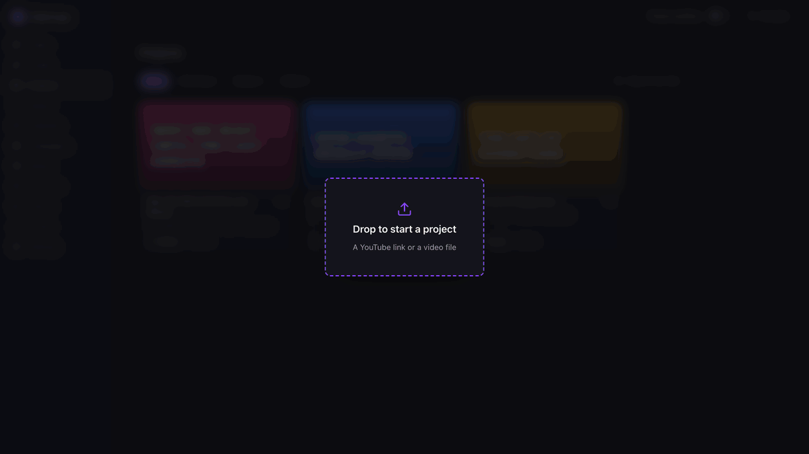
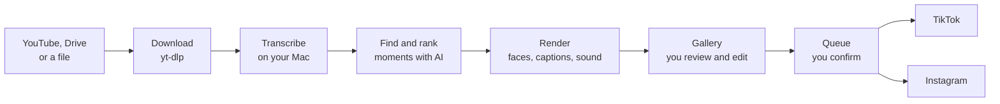
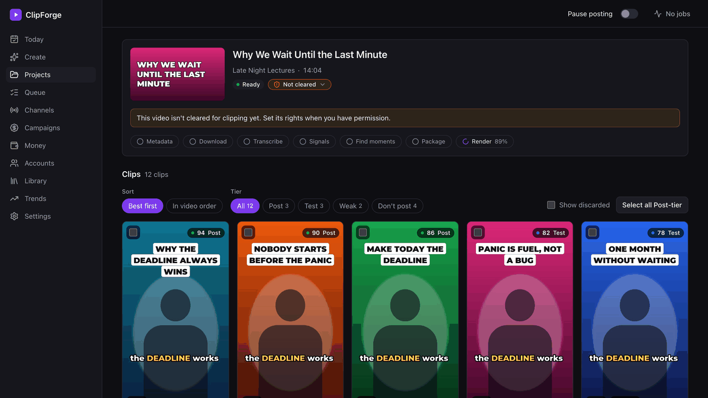
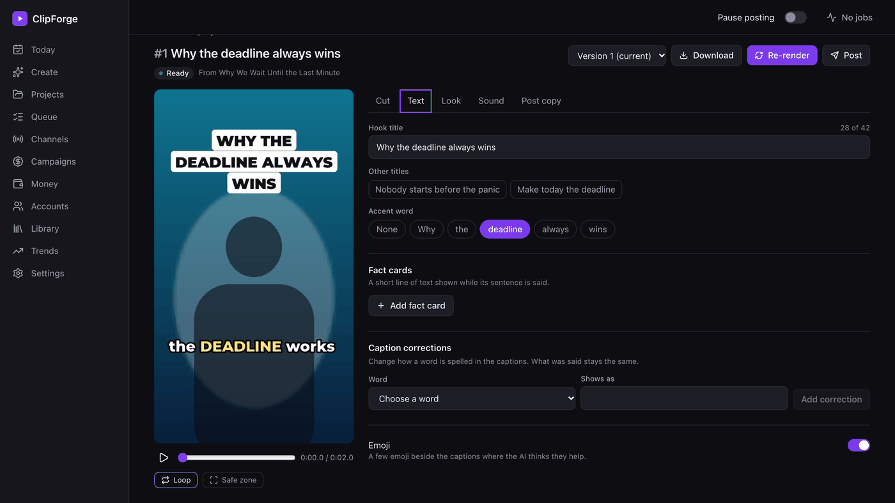
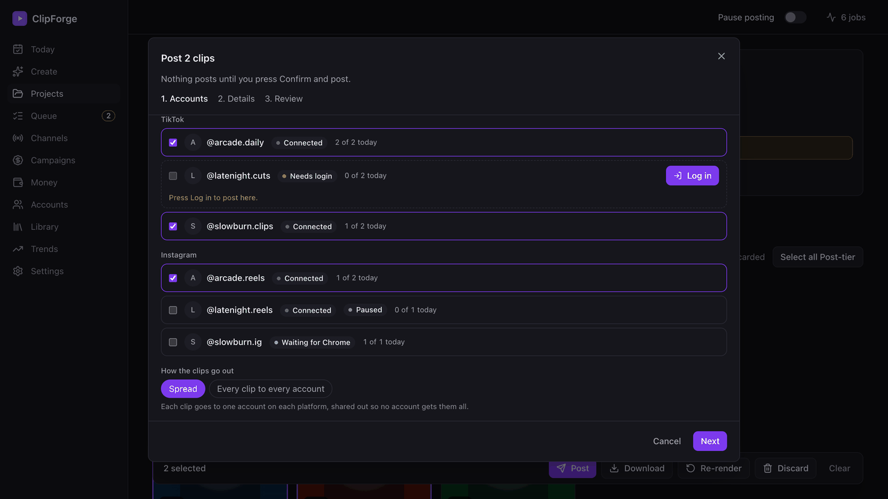
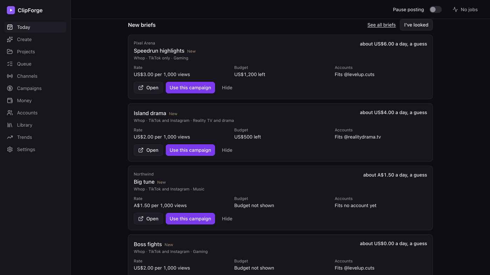
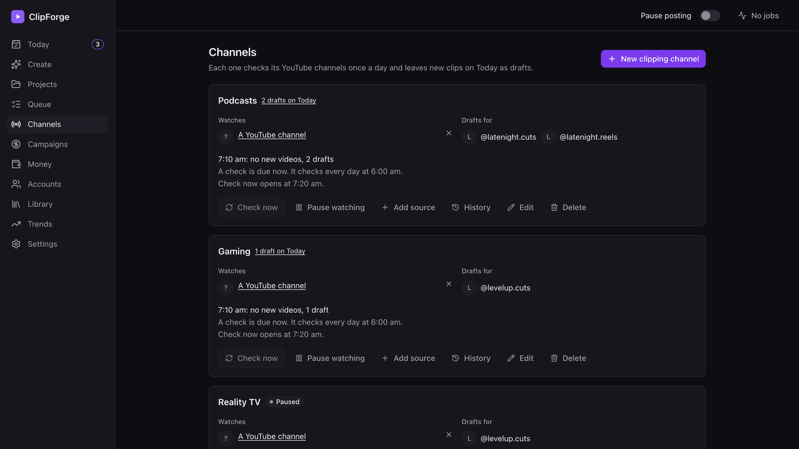
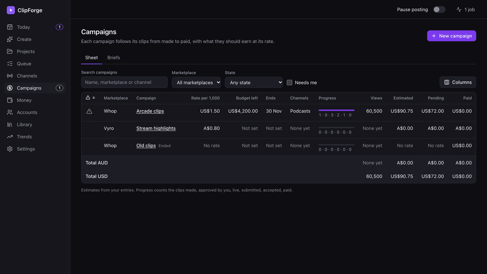

<div align="center">

# ClipForge

**Long videos in, short clips out. On your own Mac.**

Drop in a YouTube link, a Google Drive link or a video file. ClipForge finds the moments worth clipping, cuts them into captioned vertical shorts and, when you say so, posts them to your TikTok and Instagram accounts.

[](LICENSE)




<sub>The screens use made-up demo data, and the people in the clips are placeholder silhouettes.</sub>

</div>

## Why ClipForge

Hosted clipping tools usually charge by the month, count your minutes and keep your videos on their servers. ClipForge makes a different trade.

**No minutes to run out of.** Transcription, face tracking and rendering all run on your Mac, using its GPU. The app is free and open source.

**You pick the AI.** Use your Claude subscription through Claude Code (the default), an Anthropic or Gemini API key, any OpenAI-compatible server including one on your own machine, or no AI at all for basic picks.

**It explains itself.** Every clip comes with a score and the reason for it, sorted into Post, Test, Weak and Don't post, so you aren't watching forty clips to find four.

**Nothing posts behind your back.** Daily drafts wait for your approval, and a post only goes out after you press Confirm and post.

## What it does

### Makes the clips

- Finds and ranks the best moments in a long video, each with a hook title and alternatives to pick from
- Renders 1080x1920 clips with word-by-word captions, speaker tracking and loudness set for TikTok and Reels
- Lets you trim, retitle, restyle and re-render any clip in a proper editor, with versions you can go back to
- Adds a cold open, your own recorded voiceover, music, sound effects, fact cards or starter gameplay
- Keeps a style kit per account, so each channel keeps its own look

### Posts them

- Runs several TikTok and Instagram accounts side by side, with a daily limit per account
- Spreads clips across accounts, or sends every clip to every account
- Posts to Instagram through Meta's official API
- Posts to TikTok through a real Chrome window per account, which you log into once, with an assisted mode that stops before the last click
- Always lets you download a clip and post it by hand instead

### Runs the daily routine

- **Clipping channels** watch YouTube channels once a day and leave new clips on Today as drafts
- **Today** is one page for what needs you, with a guided path of 22 steps from install to your first paid clip
- **Campaigns and Money** track paid clipping campaigns from made to paid, with what each should earn at its rate
- **Briefs** reads public campaign pages, advises which accounts fit, and puts reposting campaigns first, since those are the quickest money
- **Post as it is** posts a campaign's ready-made video untouched instead of cutting it up
- **Trends** shows what is moving and builds a music library from sources you can actually use

## How it works



Built with Python 3.12, FastAPI and SQLite on the engine side, React 19, Vite and Tailwind in the window, parakeet-mlx for speech, OpenCV for faces, ffmpeg for rendering, yt-dlp for downloads and Playwright for driving Chrome.

## Screens

<table>
<tr>
<td width="50%"><br><sub><b>Gallery.</b> Every clip with its score and reason.</sub></td>
<td width="50%"><br><sub><b>Editor.</b> Cut, text, look, sound and post copy.</sub></td>
</tr>
<tr>
<td><br><sub><b>Posting.</b> Pick accounts and how the clips spread out.</sub></td>
<td><br><sub><b>Today.</b> What needs you, in one place.</sub></td>
</tr>
<tr>
<td><br><sub><b>Channels.</b> Daily drafts from the YouTube channels you watch.</sub></td>
<td><br><sub><b>Campaigns.</b> Paid campaigns from made to paid. Demo numbers.</sub></td>
</tr>
</table>

## Install

You need macOS on Apple silicon with Homebrew, ffmpeg (`brew install ffmpeg`), [uv](https://docs.astral.sh/uv/) (`brew install uv`), Node.js 22 or later (`brew install node`), Google Chrome and, for the AI parts, Claude Code logged in to your Claude subscription.

```sh
git clone https://github.com/ZyadKamalHamed/clipforge.git
cd clipforge
scripts/install.sh
```

It checks for what ClipForge needs and says how to get anything missing, installs the Python and web parts, downloads the speech and face models, runs `clipforge doctor` and builds ClipForge.app in `~/Applications`. `scripts/install.sh --check` only checks.

## Use

Open ClipForge.app, or run `uv run clipforge serve --open` from this folder. ClipForge opens in its own Chrome window: drop or paste a link (or a video file) anywhere in it, and it finds the moments worth clipping, renders them and shows them in the project's gallery, where you can watch, edit and re-render each clip and download the ones you want.

The same engine runs from Terminal:

```sh
uv run clipforge run "https://www.youtube.com/watch?v=arj7oStGLkU" --no-render
```

This downloads the audio, transcribes it on your Mac, finds and ranks the best moments and prints them with their hook titles. Your data lives in `~/ClipForge` (set `CLIPFORGE_HOME` to use another folder).

### Guides

New here? [Setting up ClipForge](docs/guides/setup.md) goes from install to your first real post, and [A clip's look](docs/guides/look.md) covers style kits per account, the cold open, recording your own voiceover and the starter gameplay with its terms.

- [Today](docs/guides/today.md): the daily page and the guided path
- [Posting to TikTok](docs/guides/tiktok.md): logging in each account once in its own Chrome window, the self-test, assisted posts and what Needs you means
- [Posting to Instagram](docs/guides/instagram.md): Creator or Business accounts, linking through a Facebook Page or with Instagram login, the token, trial reels, and the public address the second way needs
- [Clipping channels](docs/guides/clipping-channels.md): watching YouTube channels, the daily check, what gets skipped, and approving the drafts
- [Campaigns](docs/guides/campaigns.md), [Briefs](docs/guides/briefs.md) and [Money](docs/guides/money.md): paid clipping work, from finding it to being paid
- [Trends](docs/guides/trends.md) and [Music](docs/guides/music.md): what is moving and what you can safely use

## What leaves your Mac

Your videos stay on your Mac until you post them, but "local" has limits, so here they are.

- **Transcript text** goes to the AI you chose, unless that AI runs on your own machine or you pick no AI. Pictures and video don't.
- **Posts** go to TikTok and Instagram when you confirm them.
- **Downloads and lookups** reach YouTube, Google Drive, the model hosts at install, and the public pages behind Trends and Briefs.
- **Logins** stay on your Mac: TikTok sessions in a private Chrome profile per account, Instagram tokens in the macOS Keychain.
- **Analytics:** there are none. ClipForge has no telemetry of its own.

## Where it really stands

ClipForge is early, and it is worth being straight about what has and hasn't been proven.

The automated test suite is large (2,747 tests at last count) and it passes, but it runs against mocks and look-alike pages on purpose, so that no test can ever touch a real account. Real runs have produced real clips, and logging into TikTok has been tried for real and works through the QR code. The first real posts haven't been made yet, and Google Drive links haven't been tried against real Google. It only runs on Apple silicon Macs, because the speech models use MLX.

Bug reports are very welcome. Code comments that cite "SPEC" or "research" numbers point at private design notes that aren't in this repo.

## Use it responsibly

**Only post what you have the rights to.** Clips stay marked Not cleared yet until you say otherwise, and the review step warns you before you post them. Clipping programmes that pay for clips usually grant those rights, but check the brief.

**Platform rules are yours to follow.** Browser automation, reposting and running many accounts can get an account limited, so read each platform's rules first. ClipForge has no stealth plugins, proxies, fingerprint tricks, CAPTCHA solving or duplicate-check tricks, and none will be added.

**It stays out of marketplaces.** ClipForge never logs into, joins, submits to or automates Whop, Vyro or any payout service, and never stores payment details.

ClipForge is not affiliated with TikTok, Instagram, YouTube, Google, Whop or Vyro.

## Develop

```sh
uv sync --all-groups
npm --prefix web ci
npm --prefix web run build
uv run pytest -q
uv run ruff check .
```

Issues and pull requests are welcome.

## Licence

[MIT](LICENSE). The bundled fonts keep their own licences, kept beside them in `clipforge/assets/fonts`.

---

<div align="center">

Created by [Zyad Kamal Hamed](https://github.com/ZyadKamalHamed). If ClipForge saves you time, a star helps other people find it.

</div>
